# Resume Screening and Ranking

Rank resumes against one job description and explain which skills and signals support each rank.

[](https://github.com/Cyrusz55/FUTURE_ML_03/actions/workflows/ci.yml)
[](LICENSE)

## Live demo

Try the deployed application at [resume-screening-system.onrender.com](https://resume-screening-system.onrender.com).

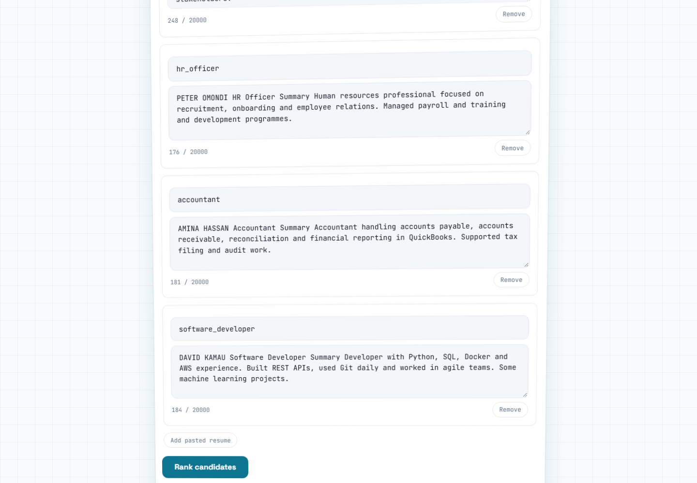
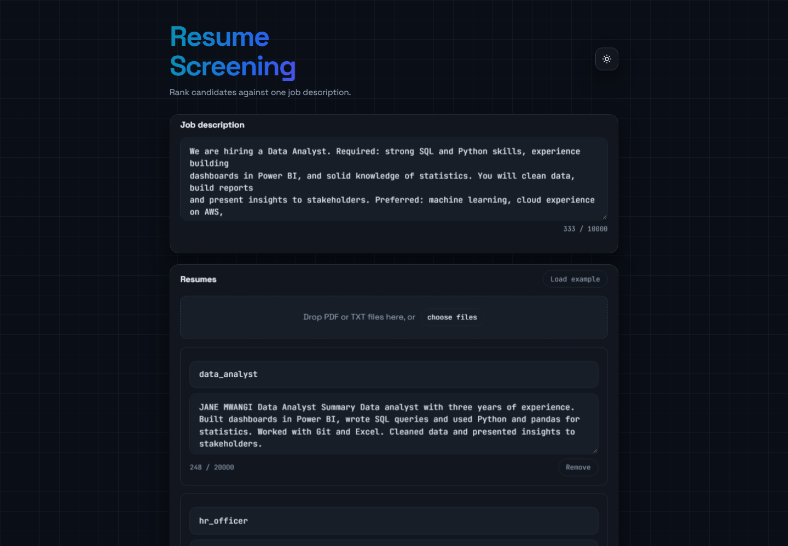

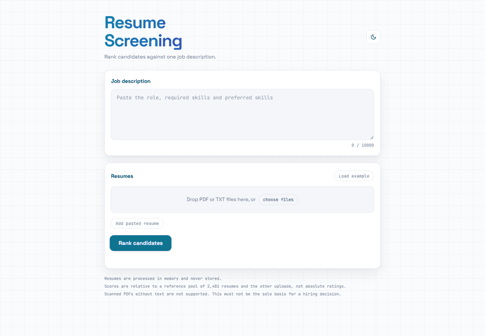

## Problem and scope

This system serves recruiters and hiring teams who need to screen a stack of resumes against one job description. It ranks uploaded resumes, reports fit and skill match scores, lists matched and missing skills, and gives a plain language explanation for each rank.

The input is one job description and from 1 to 50 resumes supplied as pasted text or PDF and TXT files. The output is one ranked result per resume.

### Explicit non goals

- It does not make a hiring decision.
- It does not use OCR for scanned PDFs.
- Its scores are relative to the 2,481 reference resumes and the other uploads, not absolute ratings.
- It must not be the sole basis for a hiring decision.
- It is a ranking and explanation system, not a trained classifier, and there is no target column.

## System flow

```mermaid
flowchart LR
    A[Job description and resumes] --> B[FastAPI validation]
    B --> C[TXT text or PDF extraction]
    C --> D[Clean text and extract skills]
    D --> E[Reference bundle loader]
    E --> F[BM25, embeddings and skill coverage]
    F --> G[Normalize and blend scores]
    G --> H[Rank and explain results]
    H --> I[Screening response]
```

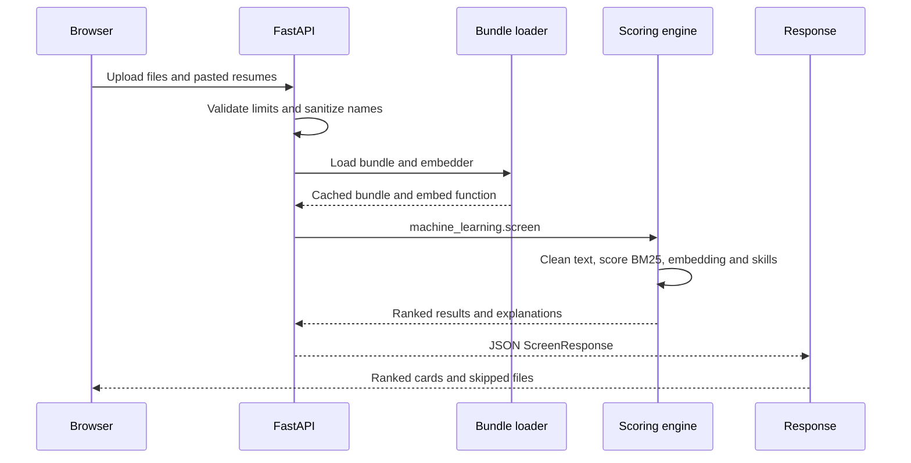

## Reference bundle

The model artefact is `model/screening_bundle.npz`, a NumPy NPZ file loaded with `allow_pickle=False`. It is not resume text. It contains derived numbers for 2,481 reference resumes, including word counts, embeddings, and extracted skill sets.

The public bundle repository is [`cyrusnx/resume_screening_bundle`](https://huggingface.co/cyrusnx/resume_screening_bundle), file `screening_bundle.npz`, pinned revision `v1`.

The bundle contains these keys:

```text
tf_data
tf_indices
tf_indptr
tf_shape
vocabulary
idf
doc_len
ref_embeddings
ref_ids
ref_categories
ref_skill_sets_json
skill_aliases_json
config_json
```

For a query and uploaded resume, the system blends BM25, embedding similarity, and skill coverage. It normalizes each component across the reference pool plus the uploaded resumes, with row min and max normalization. A fit score therefore describes how this uploaded resume compares with thousands of reference resumes and the other uploads. It is not an absolute probability of being a good candidate.

The embedding model is named and pinned in `config_json`. The application loads that exact model revision with Sentence Transformers.

## Data

This project uses the Kaggle Resume Dataset by snehaanbhawal and the Kaggle Job Description Dataset by ravindrasinghrana.

The author has not verified either dataset licence. The data is not relicensed under the MIT licence for this repository. The shipped artefact contains derived numbers only. It does not contain resume text.

## Method

Strict relevance counts exact category matches. Graded relevance gives partial credit to sensible neighbouring categories.

The graded groups from `outputs/config.json` are:

- ACCOUNTANT, BANKING, FINANCE
- BUSINESS-DEVELOPMENT, SALES
- DIGITAL-MEDIA, PUBLIC-RELATIONS
- AUTOMOBILE, AVIATION, CONSTRUCTION, ENGINEERING

The text cleaning step removes links and email addresses and preserves letters, digits, plus signs, and hash signs. It also removes a leading run of capitalized title words before scoring, because that title can leak the category label.

The notebook found that only about 37 percent of ADVOCATE resumes mention any legal word and about 63 percent mention none. Poor ADVOCATE queries and the crude legal word audit showed that its label was not trustworthy ground truth, so ADVOCATE was excluded from the evaluation queries. ADVOCATE resumes remain in the reference pool as ordinary distractors.

The hybrid blend from `outputs/config.json` is:

| Component | Weight |
|---|---:|
| BM25 | 0.1 |
| Embedding | 0.8 |
| Skills | 0.1 |

## Results

These are held out test results.

| Method | P@10 | MRR | NDCG@10 | NDCG@10 graded |
|---|---:|---:|---:|---:|
| TF IDF | 0.457 | 0.575 | 0.452 | 0.535 |
| BM25 | 0.466 | 0.609 | 0.465 | 0.531 |
| minilm full | 0.476 | 0.617 | 0.473 | 0.562 |
| minilm chunked | 0.454 | 0.584 | 0.445 | 0.53 |
| bge_small full | 0.503 | 0.627 | 0.494 | 0.557 |
| bge_small chunked | 0.451 | 0.627 | 0.451 | 0.529 |
| Skills only | 0.182 | 0.173 | 0.16 | 0.243 |
| Hybrid | 0.486 | 0.596 | 0.48 | 0.561 |

### Graded NDCG@10 with 95% bootstrap confidence intervals

| method | NDCG@10 graded | CI low | CI high |
|---|---:|---:|---:|
| TF IDF | 0.535 | 0.459 | 0.613 |
| BM25 | 0.531 | 0.46 | 0.602 |
| Best embedding (minilm full) | 0.562 | 0.481 | 0.637 |
| Hybrid | 0.561 | 0.479 | 0.637 |

The confidence interval differences in `outputs/readme_results.md` are:

- Hybrid minus TF IDF: 0.026 (95% CI -0.015 to 0.068)
- Hybrid minus BM25: 0.031 (95% CI -0.019 to 0.079)

The honest claim is that the hybrid is on par with the best single method and adds skill based explanations. The difference versus TF IDF is not significant. The confidence intervals are wide.

Negative findings:

- Chunking did not help. Whole resume embedding performed better for both embedding models.
- Skills only ranking is weak.

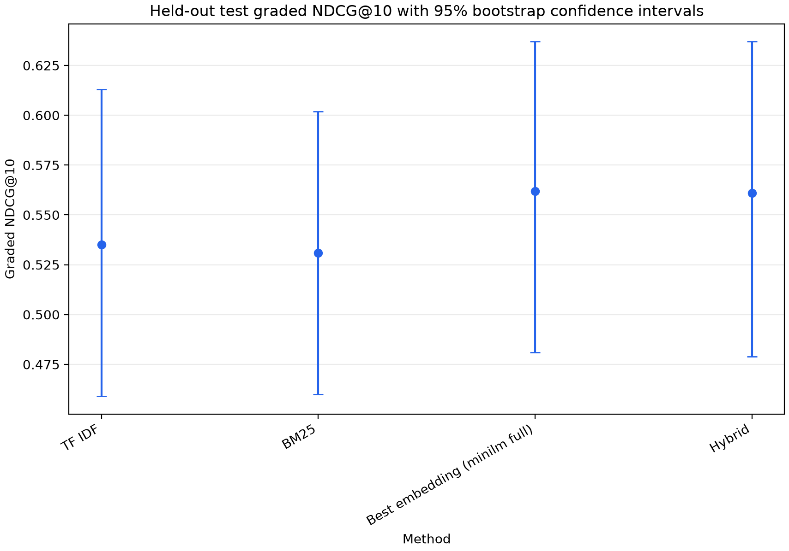
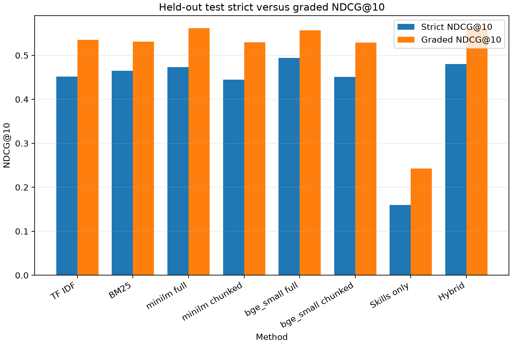
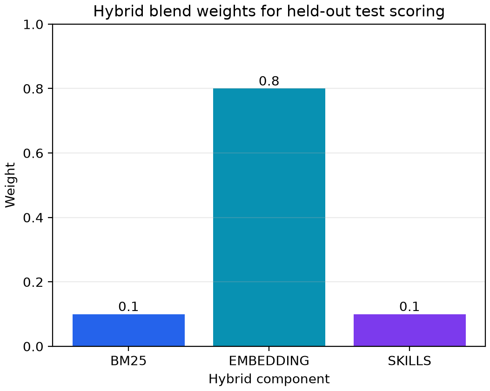

The comparison and candidate images below came from the notebook:

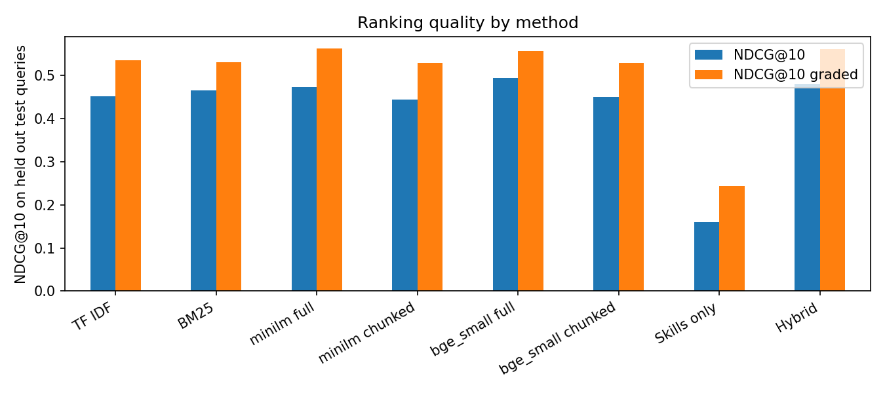
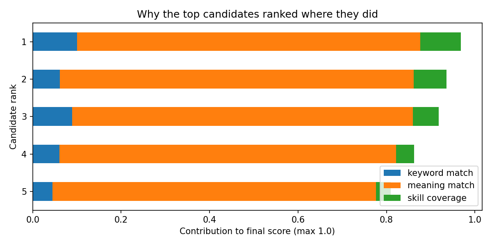

## Figures provenance

- `ci_graded_ndcg.png`, `strict_vs_graded.png`, and `blend_weights.png` come from `scripts/make_figures.py`.
- `ui_empty.png`, `ui_result_light.png`, `ui_result_dark.png`, `ui_error.png`, and `demo.gif` come from `scripts/capture_ui.py`.
- `method_comparison.png` and `top_candidates.png` came from the notebook.

## API reference

All routes are under `/api/v1`.

| Route | Method | Input | Response |
|---|---|---|---|
| `/health` | GET | No body | `status`, `model_loaded` |
| `/model-info` | GET | No body | Repository metadata, embedding metadata, reference count, weights, minimum skill weight, limits, library versions |
| `/screen` | POST | `job_description`, `resumes` | `jd_skills`, ranked `results`, `skipped` |
| `/screen/files` | POST | Multipart `job_description`, `files`, `pasted_texts` | `jd_skills`, ranked `results`, `skipped` |

### Request fields

| Field | Type | Limit or meaning |
|---|---|---|
| `job_description` | string | 30 to 10,000 characters after trimming; cannot be blank |
| `ResumeIn.name` | string or null | Optional; stripped, blank becomes null, at most 100 characters |
| `ResumeIn.text` | string | 50 to 20,000 characters after trimming; cannot be blank |
| `resumes` | array | 1 to 50 resume objects |

### Response fields

| Field | Type | Meaning |
|---|---|---|
| `jd_skills` | object | Skill names mapped to required or preferred weights |
| `name` | string | Uploaded or pasted resume name |
| `rank` | integer | Rank in ascending rank order |
| `score` | number | Fit score from 0 to 100 |
| `skill_match_pct` | number | Weighted skill match percent from 0 to 100 |
| `matched` | array | Matched job skills |
| `missing_required` | array | Missing required job skills |
| `missing_preferred` | array | Missing preferred job skills |
| `strongest_signal` | string | Keyword match, meaning match, or skill coverage |
| `summary` | string | Plain language ranking explanation |
| `skipped.name` | string | Sanitized file name or pasted resume name |
| `skipped.reason` | string | Short reason with no resume content |
| `status` | string | `ok` or `degraded` |
| `model_loaded` | boolean | Whether the cached bundle and embedder are ready |

### Limits

| Limit | Value |
|---|---:|
| Maximum resumes | 50 |
| Minimum resume characters | 50 |
| Maximum resume characters | 20,000 |
| Minimum job description characters | 30 |
| Maximum job description characters | 10,000 |
| Maximum PDF bytes | 5,242,880 |
| Maximum PDF pages | 20 |
| Maximum total multipart upload bytes | 26,214,400 |

Name length is separately limited to 100 characters.

### Health and model information

```powershell
curl "http://127.0.0.1:8000/api/v1/health"
curl "http://127.0.0.1:8000/api/v1/model-info"
```

### JSON screening

```powershell
curl -X POST "http://127.0.0.1:8000/api/v1/screen" `
  -H "Content-Type: application/json" `
  -d '{\"job_description\":\"Required: strong SQL and Python skills.\",\"resumes\":[{\"name\":\"Example candidate\",\"text\":\"JANE Example Summary Analyst with SQL and Python experience. Built reports and presented findings.\"}]}'
```

### Multipart screening

```powershell
curl -X POST "http://127.0.0.1:8000/api/v1/screen/files" `
  -F "job_description=Required: strong SQL and Python skills." `
  -F "pasted_texts=JANE Example Summary Analyst with SQL and Python experience. Built reports and presented findings."
```

The file route accepts `.pdf` and `.txt` files. PDF text is extracted only if extractable text exists. Scanned PDFs return a skipped item. Unsupported files, unreadable files, oversized files, and too short text also return skipped items while readable resumes are scored.

HTTP 413 is returned when the content length exceeds the multipart limit. HTTP 422 is returned for invalid requests and when no readable resume remains. HTTP 503 is returned when the screening context cannot load.

## User interface


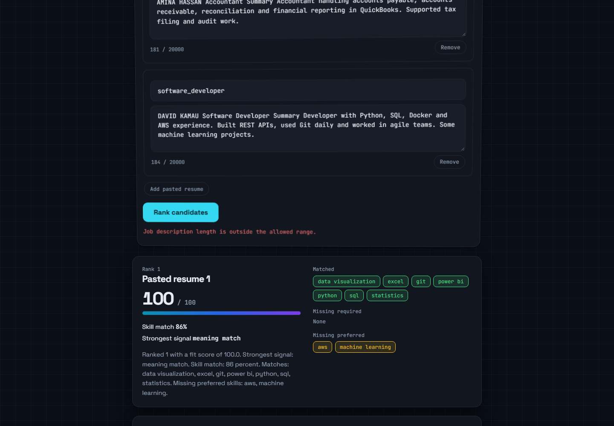

## Project structure

```text
FUTURE_ML_03/
├── apps/
├── docs/images/
├── frontend/
├── machine_learning/
├── model/
├── notebooks/
├── outputs/
├── scripts/
├── tests/
├── Dockerfile
├── docker-compose.yml
├── LICENSE
├── pyproject.toml
├── requirements.txt
└── requirements_dev.txt
```

## Run locally

Use Python 3.13.

```powershell
py -3.13 -m venv .venv
.venv\Scripts\Activate.ps1
python -m pip install -r requirements_dev.txt
python -m uvicorn apps.main:app --host 0.0.0.0 --port 8000 --reload
```

Open <http://127.0.0.1:8000/>.

The public bundle and embedding model are downloaded when the application first needs them.

## Run with Docker

```powershell
docker compose up --build
```

The Docker image downloads the public bundle and the exact embedding model revision at build time. It runs as a non root user and starts one uvicorn worker.

The Dockerfile uses CPU only PyTorch and asserts that `torch.version.cuda` is `None`.

## Configuration

| Variable | Purpose | Required |
|---|---|---|
| `PORT` | Container HTTP port; uvicorn and Docker compose use it | No; defaults to `8000` |
| `CORS_ORIGINS` | Comma separated browser origins | No; localhost ports `8000` and `8001` are defaults |
| `HF_HOME` | Hugging Face cache directory | No; Docker sets `/home/app/.cache/huggingface` |
| `HF_TOKEN` | Hugging Face upload authentication | Only for `scripts/upload_model.py` |

There is no `DATABASE_URL` in this project.

Never commit `.env`. Public bundle and embedding downloads do not require `HF_TOKEN`.

## Deployment and CI

The CI workflow runs on pushes and pull requests to `main`. It tests with Python 3.13, installs the pinned runtime and development requirements, runs Ruff, runs pytest with Hugging Face tests deselected, downloads the public bundle, builds and loads the Docker image, and runs health and made up example smoke tests.

The Docker job writes the image size and container memory to the GitHub step summary. It also runs a continue on error 512 MB container test and reports whether startup or screening survived or caused an OOM kill.

On pushes to `main`, the workflow pushes the lowercased GHCR image name tagged with `latest` and the commit SHA. The deployment job calls `RENDER_DEPLOY_HOOK_URL` only when the secret is set, then polls `LIVE_URL/api/v1/health`.

GitHub Actions measured a Docker image size of 2.96GB and container memory of 420.5MiB for a small made up example. It survived the 512 MB limit.

This measurement does not cover a worst case request with 50 long resumes. Free hosting also uses a slow CPU.

Dependabot checks pip, GitHub Actions, and Docker dependencies weekly. The pip ecosystem ignores torch, sentence transformers, spacy, NumPy, SciPy, and scikit learn because dependency bumps can change scores against the parity fixture.

## Limitations

- Category labels are a proxy for real hiring decisions.
- The ADVOCATE category was excluded.
- Job descriptions are synthetic.
- Scores are relative to the reference pool and are not absolute ratings.
- Confidence intervals are wide.
- Dataset licences were not verified.
- Scanned PDFs without extractable text are skipped.
- The skill dictionary is hand written and may cover some fields better than others.
- The 2,481 reference resumes and the upload pool affect every fit score.

## Privacy

Resumes are processed in memory and are never stored. The application and logging paths do not record resume text, job description text, or file names.

## Author and licence

Created by **Cyrus Ndung'u** ([Cyrusz55](https://github.com/Cyrusz55)).

The code is licensed under the [MIT Licence](LICENSE). The Kaggle data licences were not verified and that data is not covered by the MIT licence.

This project was completed as part of Future Interns, Machine Learning Task 3.
